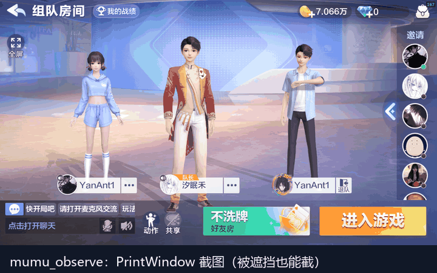

# dsh-plugin-mumu

English | [简体中文](README.md)

> 📦 Latest release: [download the zip](https://github.com/WSIKUN5/dsh-plugin-mumu/releases/latest) — unzip and install, no clone needed.

Turn **MuMu Player** (Windows Android emulator) into a set of `mumu_*` tools plus a `mumu-skill` playbook for [DeepSeek Harness](https://github.com/deepseek-ai/deepseek-harness).

The model can drive the emulator the same way `browser-skill` drives a browser: **observe the screen, tap, swipe, press keys, type text, run Android shell commands, wait for on-screen changes, OCR text, install/uninstall apps, and address multiple emulator instances** — so it can operate any app inside the emulator. A battle-tested Doudizhu (Chinese card game) reference is included as an example.



- Screenshots use `PrintWindow(render window)`, so **the game is captured cleanly even when the emulator window is covered**
- Taps use `SendInput` absolute coordinates plus cursor-position verification; because MuMu polls the system cursor to decide touch points, a tap is **refused** when the cursor is not settled
- Time-critical actions (2–3s countdowns) use local `mumu_wait` polling instead of extra model round-trips
- OCR uses Windows' built-in `Windows.Media.Ocr` — **offline, nothing leaves the machine**

## Tools

| Tool | Purpose |
| --- | --- |
| `mumu_info` | Instances / render-window handles and rect / foreground window; `probe` reads model, SDK, resolution, guest IP; `all` lists every instance |
| `mumu_observe` | PrintWindow screenshot (works even when covered), optional region crop and color probes; returns image + frame hash |
| `mumu_tap` | Tap at render-window pixel; verifies cursor first; refuses when the user is moving the mouse |
| `mumu_swipe` | Stepped drag (scroll lists / pages / sliders) |
| `mumu_key` | Android keys (back / home / task / enter / volume…, numeric keycodes) |
| `mumu_text` | ASCII text input |
| `mumu_shell` | Android shell on the guest (getprop / pm / am / dumpsys / wm …) |
| `mumu_app` | list / start / stop / uninstall / install (install via host adb over the bridged network) |
| `mumu_wait` | Local polling for an on-screen condition, optionally tap immediately (the key to timed actions) |
| `mumu_scan` | Column clustering on a band plus brightness sampling (card ranks, icon rows) |
| `mumu_ocr` | Windows offline OCR; returns text lines with render-window coordinates |

`mumu-skill` is the playbook layer: workflow, coordinate conventions, hard constraints, troubleshooting, and `references/doudizhu.md` with verified coordinates and color predicates.

## How it works

MuMu Player 15 places each app on its own virtual display (on the test machine: game = display 3, Settings = display 5, launcher = display 0). `adb screencap` only captures display 0, therefore:

- **Screenshots** = `PrintWindow(render_wnd, PW_RENDERFULLCONTENT)`;
- **Taps** = `ForceForeground(main window)` + `SendInput` absolute coordinates, verifying `GetCursorPos()` before pressing;
- **Android commands** = `MuMuManager.exe sh -c "<cmd>"`;
- **OCR** = PowerShell 7 loads CsWinRT projection assemblies and calls `Windows.Media.Ocr` offline.

The Win32 P/Invoke and pixel work live in `lib/mumu-worker.ps1` (a long-lived PowerShell process speaking JSON-lines). `index.js` only validates arguments, shapes results, and turns screenshots into Harness attachments.

## Requirements

- Windows 10 / 11
- [MuMu Player](https://mumu.163.com/) (default `D:\MuMuPlayer`, configurable)
- DeepSeek Harness desktop 0.2.x with PowerShell 7
- No extra Node dependencies — the plugin only imports Node built-ins

## Install

1. Clone this repository, or download and unzip the [latest release](https://github.com/WSIKUN5/dsh-plugin-mumu/releases/latest), e.g. to `D:\dsh-plugin-mumu`;
2. Adjust paths in `cordis.patch.yml` if needed (see below);
3. In DeepSeek Harness:

```text
plugin_manager({ action: "install_bundle", target: "D:\\dsh-plugin-mumu" })
```

4. Tools are available immediately. After editing the code, reload the plugin (`plugin_manager` toggling `dsh-plugin-mumu` off and on) or restart DSH.

> Local directory installs are **junction links**, so `git pull` / file edits update the live plugin.

## Configuration (`cordis.patch.yml`)

| Key | Default | Description |
| --- | --- | --- |
| `managerPath` | `D:\MuMuPlayer\nx_main\MuMuManager.exe` | MuMuManager path |
| `adbPath` | `adb.exe` next to MuMuManager | Used only by `mumu_app install` |
| `instance` | `0` | Default instance index |
| `captureDir` | `D:\MuMuCaptures` (or `%TEMP%\dsh-mumu` when unset) | Where screenshots are saved |
| `pwshPath` | `pwsh` | PowerShell 7 executable |
| `respectUserMouse` | `true` | Require the system cursor to be idle before tapping |
| `workerIdleTimeoutMs` | `600000` | Worker idle shutdown |

## Usage

Load the playbook in DeepSeek Harness:

```text
skill({ name: "mumu-skill" })
```

Then just ask, e.g. "take a look at the emulator", "click into the game for me". Typical tool loop:

```text
mumu_info({ probe: true })                       // instance, render rect, guest IP
mumu_observe({ maxWidth: 1000 })                  // screenshot, inlined as an image
mumu_tap({ x: 1504, y: 895 })                     // tap at render-window pixels
mumu_wait({                                        // wait + tap the instant it appears
  timeoutMs: 30000, intervalMs: 350,
  predicate: { type: "color", region: { x0: 590, y0: 520, x1: 750, y1: 560 }, color: { preset: "orange" }, minRatio: 0.5 },
  tap: { x: 665, y: 541 }
})
mumu_ocr({ region: { x0: 0, y0: 0, x1: 1763, y1: 200 }, scale: 2 })   // text with coordinates
mumu_shell({ cmd: "getprop ro.product.model" })                        // guest shell
mumu_app({ action: "start", package: "com.qqgame.hlddz" })             // launch an app
mumu_info({ all: true })                                               // list instances
mumu_observe({ instance: 1 })                                          // operate instance 1
```

**One coordinate system**: every `x/y` is a render-window pixel (screenshot top-left = 0,0, size = `renderRect` width×height from `mumu_info`). Do not use screen coordinates or the Android 1440×2560 size.

### Safety

- `mumu_tap` first checks that the system cursor is idle, moves it, and verifies the position; if it cannot land, the tap is skipped and `clicked:false` is returned;
- Taps bring MuMu to the foreground (inherent to the injection approach);
- Tools execute serially — no concurrent injection.

## Layout

```
index.js                Host plugin: registers mumu_* tools + mumu-skill, turns images into attachments
lib/mumu-worker.ps1     Long-lived PowerShell worker: Win32 P/Invoke, capture, tap, wait, scan, shell
lib/mumu-ocr.ps1        OCR helper: Windows.Media.Ocr via PowerShell 7 + CsWinRT projections
lib/winrt/              CsWinRT projection assemblies (WinRT.Runtime + Microsoft.Windows.SDK.NET, MIT)
skill/SKILL.md          Playbook (workflow and hard constraints)
skill/references/       Doudizhu coordinates and predicates; troubleshooting
locale/ icon.svg        Plugin-manager display metadata
test/                   Standalone tests (no DSH needed)
docs/demo.gif           Demo animation
```

## Testing / development

You can test the worker without DeepSeek Harness:

```powershell
node test/smoke.mjs                 # info / capture / shell / scan / wait
node test/smoke.mjs --tap 100 300   # tap (100,300) and capture the result
node test/new-features.mjs          # info all / invalid instance / OCR with region offset
node test/calibrate.mjs 700 400     # tap calibration (pair with Android show_touches)
```

Helpers used during validation: `test/jitter.ps1` (fake user mouse movement), `test/jitter-tap.mjs`
(asserts the tap is refused), `test/occluder-win32.ps1` (covers the window to verify PrintWindow).
The README demo GIF is produced by `test/demo-capture.mjs` (frames) and `test/build-demo-gif.py` (GIF).

## Known limitations

- **MuMu-specific**: relies on MuMu's render-window structure and `MuMuManager`; other emulators are untested.
- **OCR**: the Windows OCR engine cannot read gradient/outlined/artsy display type even at higher `scale`; use screenshots for those.
- **Key hold / combinations**: `mumu_key` only sends a single keyevent; use `mumu_shell` with `input swipe` for long-press.
- **Multiple instances**: addressing and operations are verified, but cursor injection is serial — not for high-frequency control of two instances at once.
- **Geometry**: after moving/restarting the window call `mumu_info({ refresh: true })`.
- Windows only (PowerShell + Win32 APIs).

## Disclaimer

Use this only on your own machine, against emulators and apps you are authorized to control. Respect the terms of service of the target apps/games and local laws. The author is not responsible for account bans, data loss, or any damage caused by using this tool.

## License

MIT — see [LICENSE](LICENSE).

The two assemblies under `lib/winrt/` come from Microsoft CsWinRT (MIT); origin and replacement instructions are in [lib/winrt/README.md](lib/winrt/README.md).
